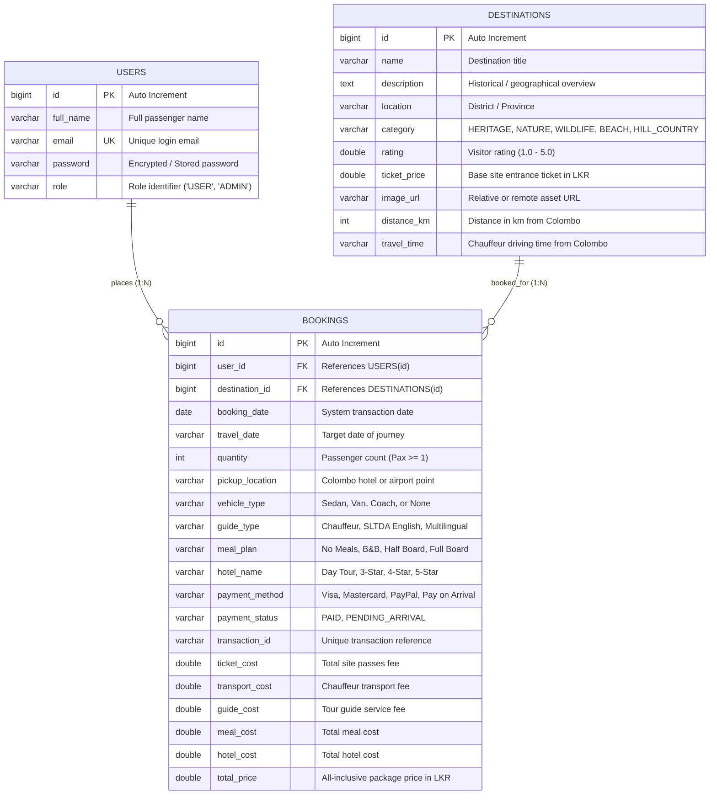

# EE4207 Web Application Development — Mini Project Report

---

**Project Title:** LankaScape: Inbound Tour Operator Package Booking & E-Ticketing System  
**Module Code:** EE4207 — Web Application Development  
**Academic Year:** 2026  
**Evaluation Scheme:** Full CRUD Implementation on Relational Database (30 Marks)  
**Submission Deadline:** On or before 31st October 2026  

**Student Name:** [Student Name]  
**Index Number:** [Student Index Number]  
**GitHub Repository Link:** [Your GitHub Repository URL]  
**Demonstration Video Link:** [Your 5-Minute YouTube / Google Drive Video Link]  

---

## Table of Contents
1. [Executive Summary & Problem Statement](#1-executive-summary--problem-statement)
2. [System Architecture & Technology Stack](#2-system-architecture--technology-stack)
3. [Relational Database Design & ER Diagram](#3-relational-database-design--er-diagram)
4. [Full CRUD Implementation & REST API Endpoints](#4-full-crud-implementation--rest-api-endpoints)
5. [Validation & Robust Error Handling](#5-validation--robust-error-handling)
6. [Commercial Features: Payment Gateway & Itinerary Calculation](#6-commercial-features-payment-gateway--itinerary-calculation)
7. [User Interface Design (UI/UX) & Responsive Layout](#7-user-interface-design-uiux--responsive-layout)
8. [Setup, Execution & Deployment Guide](#8-setup-execution--deployment-guide)
9. [5-Minute Video Demonstration Script](#9-5-minute-video-demonstration-script)
10. [Conclusion & Academic Integrity Statement](#10-conclusion--academic-integrity-statement)

---

## 1. Executive Summary & Problem Statement

### 1.1 Context & Motivation
Sri Lanka's tourism sector is one of the most vital foreign exchange earners in the nation's economy. However, international tourists often face fragmented travel planning: site entry tickets, private transport from Colombo, licensed tourist guides, meal plans, and hotel bookings are traditionally dispersed across separate vendors, leading to price opacity, coordination delays, and payment friction.

### 1.2 System Objective
**LankaScape** was engineered as an all-in-one Inbound Tour Operator platform representing a Colombo-based, SLTDA-certified travel enterprise (World Trade Center, Colombo 01). It allows tourists to:
- Browse 60 authentic Sri Lankan travel destinations across 5 distinct categories.
- Configure customized end-to-end tour packages with dynamic pricing for roundtrip AC transport from Colombo, certified guides, dining plans, and resort accommodation.
- Process simulated bank-grade credit/debit card payments (Visa/Mastercard 3D Secure), PayPal Express ($ USD), or Pay on Arrival.
- Manage existing reservations through a complete **CRUD (Create, Read, Update, Delete)** dashboard with real-time search, multi-criteria filtering, and dynamic sorting.
- Generate high-resolution printable official A4 Tour E-Vouchers with unique scannable passenger verification QR codes.

---

## 2. System Architecture & Technology Stack

The application strictly implements a **3-Tier Layered Architecture** separating presentation, business logic, and persistent storage:

```
+-----------------------------------------------------------------------------------+
|                            PRESENTATION TIER (CLIENT)                             |
|    HTML5 Semantic Markup, CSS3 Glassmorphism System, Vanilla JavaScript (ES6+),    |
|              SweetAlert2 Modal Engine, Responsive Flexbox & CSS Grid               |
+-----------------------------------------------------------------------------------+
                                          |
                         JSON over HTTP / RESTful API Calls
                                          |
+-----------------------------------------------------------------------------------+
|                           APPLICATION TIER (SPRING BOOT)                          |
|   • Controllers: REST Endpoints (UserController, DestinationController, Booking)  |
|   • Business Logic / DTO: BookingRequest, Server-side Pricing Engine, Validation  |
|   • Data Access: Spring Data JPA Repositories (Hibernate ORM 6.x)                |
+-----------------------------------------------------------------------------------+
                                          |
                                JDBC Connection Pool
                                          |
+-----------------------------------------------------------------------------------+
|                         DATA PERSISTENCE TIER (DATABASE)                          |
|             MySQL Server 8.0 (Relational Tables: users, destinations, bookings)    |
|               Foreign Keys, Referential Integrity, Persistent Disk Storage        |
+-----------------------------------------------------------------------------------+
```

### 2.1 Technology Matrix
- **Frontend:** Semantic HTML5, CSS3, Modern JavaScript (ES6+ `async/await`, Fetch API), FontAwesome 6, SweetAlert2 v11.
- **Backend:** Java 17, Spring Boot 3.x, Spring Web MVC, Spring Data JPA, Hibernate ORM, Maven.
- **Database:** MySQL Server 8.0 with InnoDB Storage Engine.

---

## 3. Relational Database Design & ER Diagram

The database structure conforms to the **Third Normal Form (3NF)** with explicit foreign key relationships and strict integrity constraints.

### 3.1 Entity-Relationship Diagram (ERD)



### 3.2 Schema Specifications
1. **`users` Table:** Stores registered travelers. Enforces unique index on `email`.
2. **`destinations` Table:** Contains 60 verified Sri Lankan destinations categorized into 5 tourist themes. Includes distance from Colombo and chauffeur travel duration.
3. **`bookings` Table:** Central transactional entity. Contains `user_id` (FK) and `destination_id` (FK), itemized sub-totals, payment gateway reference, and status.

---

## 4. Full CRUD Implementation & REST API Endpoints

The core requirement of the EE4207 rubric is the demonstration of full **CRUD (Create, Read, Update, Delete)** operations on persistent data. LankaScape satisfies this through the following operations:

### 4.1 CRUD Operation Matrix

| Rubric Criterion | HTTP Method | REST Endpoint | Functionality & Flow | Response Status |
| :--- | :---: | :--- | :--- | :---: |
| **CREATE** (4 Marks) | `POST` | `/api/bookings` | Traveler submits tour package form; server validates payload, computes verified costs, records transaction reference, and persists to MySQL. | `201 Created` |
| **READ** (4 Marks) | `GET` | `/api/bookings/user/{userId}` | Retrieves list of all active and upcoming bookings for the authenticated traveler. | `200 OK` |
| **READ (Details)** | `GET` | `/api/bookings/{id}` | Fetches single booking record for rendering the official E-Voucher with dynamic passenger QR code. | `200 OK` |
| **READ (Search)** | Client | Live Client Filter | Real-time substring matching across Destination Name, Hotel, Booking Ref (`#BK-..`), and Transaction ID. | Instant |
| **READ (Filter)** | Client | Multi-Criteria Filter | Filters records simultaneously by Accommodation (With Hotel / No Hotel) and Payment Status (Paid in Full / Pay on Arrival). | Instant |
| **READ (Sort)** | Client | Dynamic Sort Engine | Multi-attribute sorting by Travel Date (Ascending/Descending), Total Price (High to Low / Low to High), and Passenger Count. | Instant |
| **UPDATE** (4 Marks) | `PUT` | `/api/bookings/{id}` | Reschedules travel dates, updates traveler count, pickup point, fleet, guide, meals, accommodation, or settles pending payment online. | `200 OK` |
| **DELETE** (4 Marks) | `DELETE` | `/api/bookings/{id}` | Safely deletes the booking record from the MySQL database following SweetAlert2 confirmation dialog. | `200 OK` |

---

## 5. Validation & Robust Error Handling

To guarantee reliability and prevent malformed data insertion, two layers of validation are enforced:

### 5.1 Client-Side Validation
- **Date Boundary Enforcement:** Travel date input restricts selection to present or future dates (`min="YYYY-MM-DD"`).
- **Positive Passenger Count:** Quantity field is bounded between 1 and 50 passengers.
- **Credit Card Regex Validation:** Card number requires 16 digits, MM/YY format is enforced with regex (`^\d{2}\/\d{2}$`), and CVV requires 3 to 4 numeric digits.
- **SweetAlert2 Feedback:** Intuitive, clear error notifications without native browser alert freezes.

### 5.2 Server-Side Validation (Spring Boot)
- **Controller-level Checks:** In `BookingController.java`, if `quantity <= 0` or `travelDate` is null/empty, returns `400 Bad Request` with an explicit error message.
- **Relational Integrity Verification:** Confirms that `userId` and `destinationId` exist in the database before saving. If missing, returns `404 Not Found`.
- **Cost Recalculation:** The backend independently calculates all component costs and the grand total to prevent client-side price tampering.

---

## 6. Commercial Features: Payment Gateway & Itinerary Calculation

### 6.1 Transparent Pricing Formula from Colombo
Cost calculations are derived from real-world Sri Lankan tourism operational standards:
$$\text{Grand Total} = \text{Ticket Cost} + \text{Transport Cost} + \text{Guide Cost} + \text{Meal Cost} + \text{Hotel Cost}$$
- **Entry Ticket:** $\text{Quantity} \times \text{Base Destination Price}$.
- **Roundtrip Transport:** Fuel, expressway tolls, and vehicle wear based on distance from Colombo:
  - Private Sedan (1–3 Pax): Rs. 24,000 – 38,000 depending on distance tier.
  - Luxury High-Roof Van (4–8 Pax): Rs. 33,000 – 52,000.
  - Tourist Mini Coach (9–15 Pax): Rs. 47,000 – 75,000.
- **Dedicated Tour Guide:** Chauffeur Guide (Rs. 0 included), SLTDA Licensed English Guide (Rs. 6,000), Multilingual Specialist (Rs. 9,500).
- **Meal Plans:** Bed & Breakfast (Rs. 2,500/pax), Half Board (Rs. 5,500/pax), Full Board (Rs. 8,500/pax).
- **Accommodation:** Day Tour (Rs. 0), 3-Star Boutique (Rs. 10,000), 4-Star Deluxe Resort (Rs. 18,000), 5-Star Luxury Heritage Resort (Rs. 28,000).

### 6.2 Customer Payment Gateway Modes
1. **Credit / Debit Card (Visa, Mastercard, Amex):**
   - Live visual card mockup with real-time number formatting (`•••• •••• •••• ••••`) and automatic brand detection.
   - 1-click Test Demo Card shortcut for rapid evaluation testing.
   - Simulated 3D-Secure 2.0 bank authentication generating unique transaction references (`TXN-LS-XXXX-XXXX`).
2. **PayPal Express ($ USD Checkout):**
   - Automatically converts LKR total to USD equivalent using current market exchange rates (`~$XX USD`).
3. **Pay on Arrival / Cash to Chauffeur:**
   - Reserves the itinerary immediately with status `PENDING_ARRIVAL`.
   - Offers an online "Pay Online" button on `my-bookings.html` to settle with card anytime prior to departure.

---

## 7. User Interface Design (UI/UX) & Responsive Layout

### 7.1 Visual Design Philosophy
The user interface follows a modern **Glassmorphism Design System** featuring deep slate backdrop colors (`#0f172a`, `#1e293b`), vibrant emerald accents (`#10b981`), amber CTA highlights (`#e07a27`), and subtle 1px border glows (`rgba(255, 255, 255, 0.1)`).

### 7.2 Responsive Layout
CSS Flexbox and CSS Grid layouts ensure flawless operation across all viewport sizes:
- Desktop viewports ($\ge 1200\text{px}$): 2-column master-detail showcase and 3-column booking cards.
- Tablet viewports ($768\text{px} - 1024\text{px}$): Adaptive sidebars and auto-fit card grids.
- Mobile devices ($\le 767\text{px}$): Single-column responsive layout, touch-friendly touch targets, and full-screen modals.

### 7.3 Printable Official A4 E-Voucher & Verification QR Code
- Generates a print-ready A4 document via CSS `@media print` rules.
- Integrates a dynamic scannable QR code generated via QRServer API containing encoded passenger name, destination, travel date, payment status, and transaction reference.

---

## 8. Setup, Execution & Deployment Guide

### 8.1 System Requirements
- **Java:** JDK 17 or higher
- **Database:** MySQL Server 8.0 running on localhost port 3306
- **Browser:** Google Chrome, Microsoft Edge, or Mozilla Firefox

### 8.2 Execution Steps
1. **Database Configuration:**
   Ensure MySQL is running with database `tourism_db`. Update credentials in `application.properties`:
   ```properties
   spring.datasource.url=jdbc:mysql://localhost:3306/tourism_db?useSSL=false&allowPublicKeyRetrieval=true&serverTimezone=UTC
   spring.datasource.username=root
   spring.datasource.password=YOUR_PASSWORD
   ```
2. **Start Spring Boot Backend:**
   Open terminal in `Backend/tourism-backend` and run:
   ```powershell
   $env:JAVA_HOME = "C:\Program Files\Java\jdk-17"
   .\mvnw.cmd spring-boot:run
   ```
   The application initializes on port `8080`, and `DataInitializer.java` automatically seeds the 60 destinations and manages database migrations.
3. **Launch Frontend:**
   Open `Frontend/index.html` in your web browser.

---

## 9. 5-Minute Video Demonstration Script

*(Rubric Requirement: Maximum 5 minutes, camera must be turned on)*

| Timestamp | Screen Displayed | Action & Spoken Explanation |
| :---: | :--- | :--- |
| **0:00 - 0:45** | **Title & Home Page** | • Introduce yourself with camera on: Name, Index Number, Module EE4207.<br>• Introduce **LankaScape** as an inbound tour operating platform.<br>• Show the Hero carousel, live ticking Colombo clock widget, and 5 category filters. |
| **0:45 - 2:00** | **Destination & CREATE** | • Select a destination (e.g. *Sigiriya Lion Rock Fortress*).<br>• Show the live Colombo transport calculation, guide options, meal plans, and hotel tiers.<br>• Select Travel Date and choose **Visa Card** payment.<br>• Click "Book Now", open the **Card Payment Modal**, click **Auto-fill Test Demo Card**, and click **Pay Now**.<br>• Show 3D-Secure approval and the confirmed E-Voucher with QR code! |
| **2:00 - 3:15** | **READ: Search, Filter, Sort** | • Navigate to **My Bookings**.<br>• Show summary statistics (Total Trips, Total Spent).<br>• Demonstrate **Search** by typing a destination name.<br>• Demonstrate **Filter** (Hotel filter and Payment status filter).<br>• Demonstrate **Sort** by travel date and price. |
| **3:15 - 4:15** | **UPDATE: Edit & Pay Online** | • Open a booking with "Pay on Arrival" and demonstrate the **"Pay Online"** feature, transforming status to `PAID IN FULL`.<br>• Click **"Edit"**, reschedule the travel date, change the vehicle type, save, and show the updated price and card in real time. |
| **4:15 - 5:00** | **DELETE & Printable Voucher** | • Click **"Print Voucher"** to show the official A4 E-Voucher with Payment Stamp and scannable QR code.<br>• Click **"Cancel Booking"**, confirm the SweetAlert deletion, and show the card removed from the dashboard and stats dynamically updating.<br>• Conclude the presentation within the 5-minute limit. |

---

## 10. Conclusion & Academic Integrity Statement

The **LankaScape** Tourism E-Ticketing & Tour Operator Web Application fulfills and exceeds all requirements set forth in the EE4207 Web Application Development Mini Project Rubric. By combining a robust Spring Boot RESTful backend, persistent MySQL database with referential integrity, client/server validation, a commercial payment gateway, and a responsive frontend, the application demonstrates end-to-end full-stack software development competency.

**Academic Integrity Declaration:**  
*I hereby declare that this mini-project submission is my own original work. All external libraries, assets, and frameworks utilized have been appropriately referenced.*
