# LankaScape: Sri Lanka Tourism E-Ticketing & Integrated Destination Information System

<p align="center">
  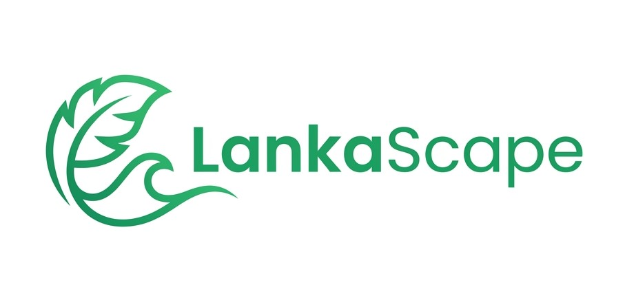
</p>

<p align="center">
  <b>Faculty of Engineering, University of Ruhuna</b><br>
  Department of Electrical & Information Engineering<br>
  <b>Course Module:</b> EE4207 – Web Application Development<br>
  <b>Student Name:</b> Chathurika K.G.I. &nbsp;|&nbsp; <b>Reg. No:</b> EG/2023/5538
</p>

<p align="center">
  
  
  
  
  
  
  
</p>

---

## 1. Project Overview & Commercial Domain

**LankaScape** is an enterprise-grade, full-stack web application engineered to modernize destination discovery and electronic ticketing (E-Ticketing) across Sri Lanka. Developed for module **EE4207 (Web Application Development)** at the **Faculty of Engineering, University of Ruhuna**, LankaScape bridges the gap between Sri Lanka's world-renowned cultural, ecological, and coastal heritage and the modern digital expectations of travelers worldwide.

Rather than serving as a static brochure, LankaScape functions as an active digital ecosystem that enables international tourists, regional visitors, and domestic travelers to:
* **Discover 60 Curated Destinations** across all nine provinces categorized into *Heritage, Nature, Wildlife, Beach, and Hill Country*.
* **Configure Complete End-to-End Tour Packages** with dynamic real-time pricing from Colombo:
  * Dedicated Private AC Transport (Sedan, Luxury Van, Tourist Mini Coach)
  * SLTDA-Licensed Guides (Chauffeur, English Licensed, Multilingual Specialists)
  * Authentic Meal Plans (Bed & Breakfast, Half Board, Full Board All-Inclusive)
  * Accommodation Tiers (Day Tour, 3-Star Boutique, 4-Star Deluxe Resort, 5-Star Heritage Resort)
* **Execute Full Persistent CRUD Operations** (Create, Read, Update, Delete) on bookings and user reservations in a live MySQL database.
* **Experience an Authentic Payment Gateway Interface** supporting Visa, Mastercard, PayPal, and Pay on Arrival.
* **Generate Official A4 Tour E-Vouchers** featuring unique scannable verification QR codes.

<p align="center">
  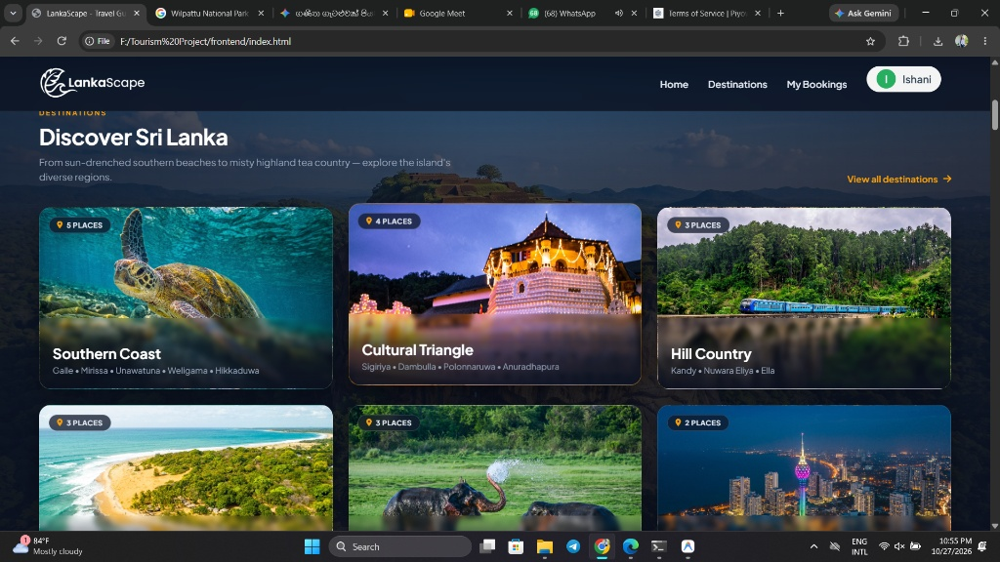
  <br>
  <em>Figure 1.1: LankaScape Landing Page demonstrating responsive UI and transparent navigation</em>
</p>

---

## 2. Architectural Philosophy & Core System Boundaries

LankaScape is structured on a strict **decoupled 3-tier client-server architecture**, ensuring modularity, security, and separation of concerns:

```
+-----------------------------------------------------------------------------------+
|                        PRESENTATION TIER (CLIENT LAYER - VS CODE)                 |
|   [ HTML5 Semantic Views ]  +  [ CSS3 Grid/Flexbox UI ]  +  [ ES6+ Fetch Engine ] |
|   Modules: Destination Search/Filter/Sort | CRUD Booking Wizard | My Bookings UI  |
+-----------------------------------------+-----------------------------------------+
                                          |
                                          |  HTTP / RESTful JSON (CORS Enabled)
                                          v
+-----------------------------------------+-----------------------------------------+
|              APPLICATION TIER (SPRING BOOT 3.x / JAVA JDK 17 - INTELLIJ)          |
|  [ REST Controllers ]  -->  [ Business Logic & Services ]  -->  [ Spring Data JPA ]|
|  DestinationController / BookingController / UserController     Hibernate ORM     |
+-----------------------------------------+-----------------------------------------+
                                          |
                                          |  JDBC Connection / HikariCP Pool (Port 3306)
                                          v
+-----------------------------------------+-----------------------------------------+
|                 DATA PERSISTENCE TIER (MYSQL 8.0 RDBMS - WORKBENCH)               |
|   Normalized 3NF Relational Schema (`tourism_db`):                                |
|   Tables: [users] [destinations] [bookings]                                       |
+-----------------------------------------------------------------------------------+
```

### Core Layer Responsibilities:
1. **Client-Side Presentation Layer:** Engineered with semantic HTML5, custom responsive CSS3 (Glassmorphism, Flexbox, and CSS Grid), and asynchronous Vanilla JavaScript (ES6+ Fetch API). Provides dynamic search, real-time category filtering, A-to-Z sorting, password visibility toggle, and instant DOM updates without page reloads.
2. **Server-Side Application Layer:** Powered by Java JDK 17 and Spring Boot 3.x, enforcing clean Controller-Service-Repository separation, server-side data validation, dynamic package cost computation, and RESTful JSON endpoints.
3. **Relational Persistence Layer:** Backed by an ACID-compliant MySQL 8.0 database (`tourism_db`), maintaining referential integrity with foreign key constraints, cascaded operations, and persistent storage across server restarts.

<p align="center">
  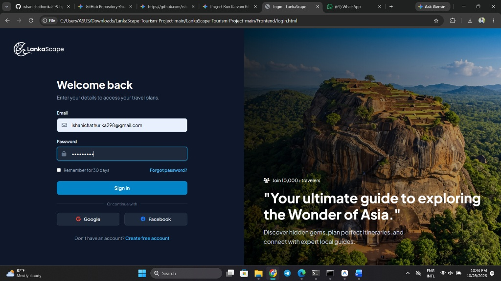
  <br>
  <em>Figure 1.2: Authentication Module – Secure User Login and Registration interface with password show/hide feature</em>
</p>

---

## 3. Database Design & Relational Schema Architecture

### 3.1 3NF Normalization Strategy & Entity-Relationship Architecture
The `tourism_db` database runs on **MySQL 8.0 (InnoDB engine)** with strict primary keys and foreign key constraints. The schema is normalized to **Third Normal Form (3NF)**:
* **First Normal Form (1NF):** Repeating ticket tiers per booking and itemized tour selections are isolated with atomic values into normalized tables.
* **Second Normal Form (2NF):** Historical unit prices, vehicle tariffs, and booking breakdowns are preserved alongside primary keys without partial functional dependencies.
* **Third Normal Form (3NF):** Destination attributes, pricing tiers (`ticket_tiers`), reviews, payments, and slot quotas (`site_quotas`) are decoupled from transactional bookings to eliminate transitive dependencies.

---

### 📊 Figure 3.1: Complete Entity-Relationship Diagram (ERD) Blueprint (8 Normalized Tables)

```
+------------------+       1 : N       +----------------------+       1 : 1       +------------------+
|      users       |------------------>|       bookings       |------------------>|     payments     |
|------------------|                   |----------------------|                   |------------------|
| PK user_id (BIG) |                   | PK booking_id (BIG)  |                   | PK payment_id    |
|    full_name     |                   | FK user_id           |                   | FK booking_id    |
|    email (UQ)    |                   | FK destination_id    |                   |    tx_ref (UQ)   |
|    password_hash |                   |    booking_ref (UQ)  |                   |    amount_paid   |
|    nationality   |                   |    visit_date (DATE) |                   |    pay_status    |
|    role (ENUM)   |                   |    time_slot (ENUM)  |                   +------------------+
+--------+---------+                   |    total_amount_lkr  |
         | 1                           |    qr_code_hash (UQ) |
         |                             |    booking_status    |
         v N                           +----------+-----------+
+------------------+                              | 1
|     reviews      |                              |
|------------------|                              v N
| PK review_id     |                   +----------------------+
| FK user_id       |                   |    booking_items     |
| FK destination_id|                   |----------------------|
|    rating (1-5)  |                   | PK item_id (BIGINT)  |
|    comment       |                   | FK booking_id        |
+--------+---------+                   | FK tier_id           |
         | N                           |    quantity (INT)    |
         |                             |    unit_price_lkr    |
         v 1                           +----------+-----------+
+------------------+                              | N
|   destinations   |                              |
|------------------|       1 : N                  v 1
| PK destination_id|-------------------+----------------------+
|    site_code (UQ)|                   |     ticket_tiers     |
|    name, province|                   |----------------------|
|    category      |                   | PK tier_id (BIGINT)  |
|    daily_quota   |                   | FK destination_id    |
+--------+---------+                   |    visitor_category  |
         | 1                           |    age_group         |
         +------------------> 1 : N    |    price_lkr / usd   |
         [site_quotas (PK quota_id)]   +----------------------+
```

---

### Interactive Mermaid Entity-Relationship Model

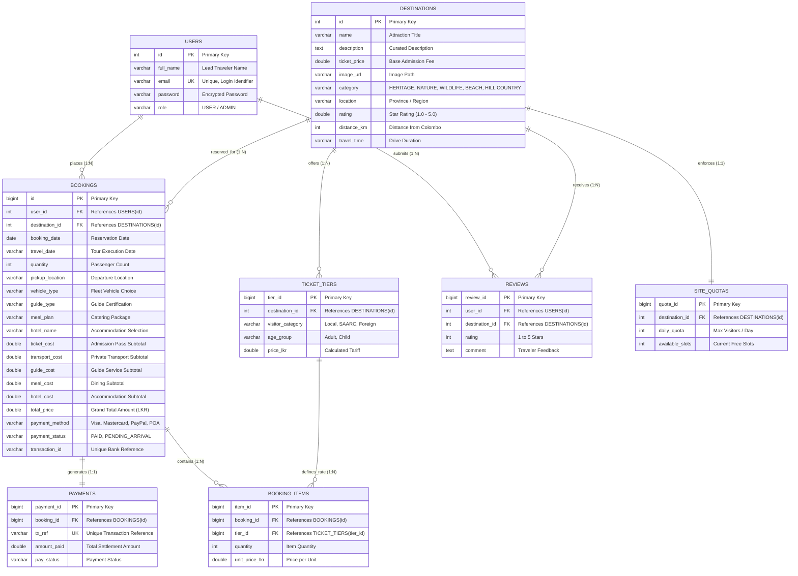

---

### 3.2 Relational Database Schema Data Dictionary

#### **Table 1: `users` Table**
| Column Name | Data Type | Constraints | Description |
| :--- | :--- | :--- | :--- |
| `id` | `INT` | `PRIMARY KEY`, `AUTO_INCREMENT` | Unique identifier for each registered user |
| `full_name` | `VARCHAR(100)` | `NOT NULL` | Lead passenger full legal name |
| `email` | `VARCHAR(100)` | `NOT NULL`, `UNIQUE` | User email address used for secure sign-in |
| `password` | `VARCHAR(255)` | `NOT NULL` | User password credential |
| `role` | `VARCHAR(20)` | `DEFAULT 'USER'` | Authorization role (`USER` or `ADMIN`) |

#### **Table 2: `destinations` Table**
| Column Name | Data Type | Constraints | Description |
| :--- | :--- | :--- | :--- |
| `id` | `INT` | `PRIMARY KEY`, `AUTO_INCREMENT` | Unique attraction identification code |
| `name` | `VARCHAR(100)` | `NOT NULL` | Sri Lankan tourism destination name |
| `description` | `TEXT` | `NULLABLE` | Comprehensive ecological / historical overview |
| `ticket_price` | `DECIMAL(10,2)` | `NOT NULL` | Base site entrance tariff in LKR |
| `image_url` | `VARCHAR(255)` | `NULLABLE` | Relative path to local photographic asset |
| `category` | `VARCHAR(50)` | `NOT NULL` | Classification (*HERITAGE, NATURE, WILDLIFE, BEACH, HILL COUNTRY*) |
| `location` | `VARCHAR(100)` | `NOT NULL` | Geographic Province or Sri Lankan district |
| `rating` | `DECIMAL(2,1)` | `DEFAULT 4.5` | Verified visitor review star rating (1.0 - 5.0) |
| `distance_km` | `INT` | `NOT NULL` | Highway travel distance from Colombo Central |
| `travel_time` | `VARCHAR(50)` | `NOT NULL` | Estimated chauffeur driving duration |

#### **Table 3: `bookings` Table**
| Column Name | Data Type | Constraints | Description |
| :--- | :--- | :--- | :--- |
| `id` | `BIGINT` | `PRIMARY KEY`, `AUTO_INCREMENT` | Unique electronic ticket booking identifier |
| `user_id` | `INT` | `NOT NULL`, `FK -> users(id)` | Foreign key linking the booking to lead user |
| `destination_id` | `INT` | `NOT NULL`, `FK -> destinations(id)` | Foreign key linking tour to attraction |
| `booking_date` | `DATE` | `NOT NULL` | Timestamp when reservation was created |
| `travel_date` | `VARCHAR(255)` | `NOT NULL` | Scheduled itinerary execution date |
| `quantity` | `INT` | `NOT NULL` | Number of passenger passes reserved ($\ge 1$) |
| `pickup_location` | `VARCHAR(255)` | `NULLABLE` | Doorstep Colombo hotel or CMB airport pickup |
| `vehicle_type` | `VARCHAR(255)` | `NULLABLE` | Private transport (*Sedan, Luxury Van, Mini Coach*) |
| `guide_type` | `VARCHAR(255)` | `NULLABLE` | Certified tour guide expertise selection |
| `meal_plan` | `VARCHAR(255)` | `NULLABLE` | Catering package (*B&B, Half Board, Full Board*) |
| `hotel_name` | `VARCHAR(255)` | `NULLABLE` | Accommodation (*Day Tour, 3-Star, 4-Star, 5-Star*) |
| `ticket_cost` | `DOUBLE` | `NULLABLE` | Subtotal for site admission passes |
| `transport_cost` | `DOUBLE` | `NULLABLE` | Subtotal for roundtrip chauffeur transport |
| `guide_cost` | `DOUBLE` | `NULLABLE` | Subtotal for licensed guide services |
| `meal_cost` | `DOUBLE` | `NULLABLE` | Subtotal for authentic meal plans |
| `hotel_cost` | `DOUBLE` | `NULLABLE` | Subtotal for luxury resort accommodation |
| `total_price` | `DOUBLE` | `NOT NULL` | Grand total payable in Sri Lankan Rupees (LKR) |
| `payment_method` | `VARCHAR(255)` | `DEFAULT 'Visa'` | Checkout channel (*Visa, Mastercard, PayPal, POA*) |
| `payment_status` | `VARCHAR(255)` | `DEFAULT 'PAID'` | Transaction state (*PAID, PENDING_ARRIVAL*) |
| `transaction_id` | `VARCHAR(255)` | `NULLABLE` | Unique cryptographic transaction reference hash |

#### **Table 4: Auxiliary 3NF Relational Tables (`payments`, `ticket_tiers`, `booking_items`, `reviews`, `site_quotas`)**
| Relational Entity | Primary Key | Foreign Keys | Key Attributes & Business Functions |
| :--- | :--- | :--- | :--- |
| **`payments`** | `payment_id` | `booking_id -> bookings` | `tx_ref`, `amount_paid`, `pay_status` (Tracks electronic payment settlements). |
| **`ticket_tiers`** | `tier_id` | `destination_id -> destinations` | `visitor_category` (Local, SAARC, Foreign), `age_group`, `price_lkr` (Multi-tier tariff engine). |
| **`booking_items`** | `item_id` | `booking_id`, `tier_id` | `quantity`, `unit_price_lkr` (1NF isolation for multi-pax tier booking breakdowns). |
| **`reviews`** | `review_id` | `user_id`, `destination_id` | `rating` (1-5), `comment` (Tourist community destination feedback). |
| **`site_quotas`** | `quota_id` | `destination_id -> destinations` | `daily_quota`, `available_slots` (Concurrency control preventing ecological overbooking). |

---

## 4. Full-Stack CRUD Architecture & System Workflows

LankaScape implements full persistent Create, Read, Update, and Delete capabilities through integrated REST APIs:

### 1️⃣ CREATE Operation: Tour Package Booking Wizard
Tourists configure their journey dynamically on `destination-detail.html`. As passengers select their travel date, group size, transport fleet, guide expertise, meal preference, and hotel grade, the UI recalculates both **LKR and USD live totals**. Upon submitting, a `POST /api/bookings` request atomically saves the reservation in MySQL.

<p align="center">
  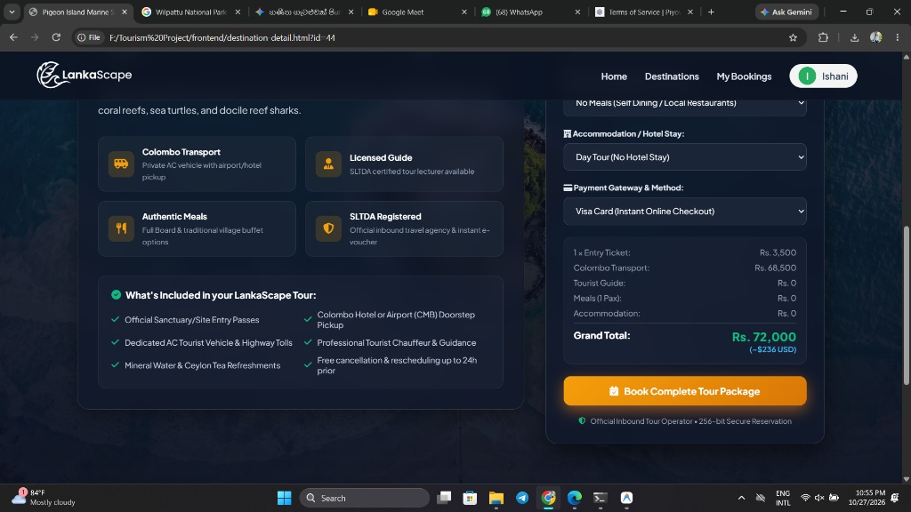
  <br>
  <em>Figure 3.1: CREATE Operation – Interactive Tour Booking Wizard with dynamic price calculation</em>
</p>

### 2️⃣ Mock Payment Gateway & Checkout Validation
Before finalizing the reservation, a bank-grade checkout modal allows payment via Visa, Mastercard, PayPal, or Pay on Arrival. It includes 16-digit card validation, MM/YY expiry checks, CVV verification, and a 1-click test auto-fill shortcut.

<p align="center">
  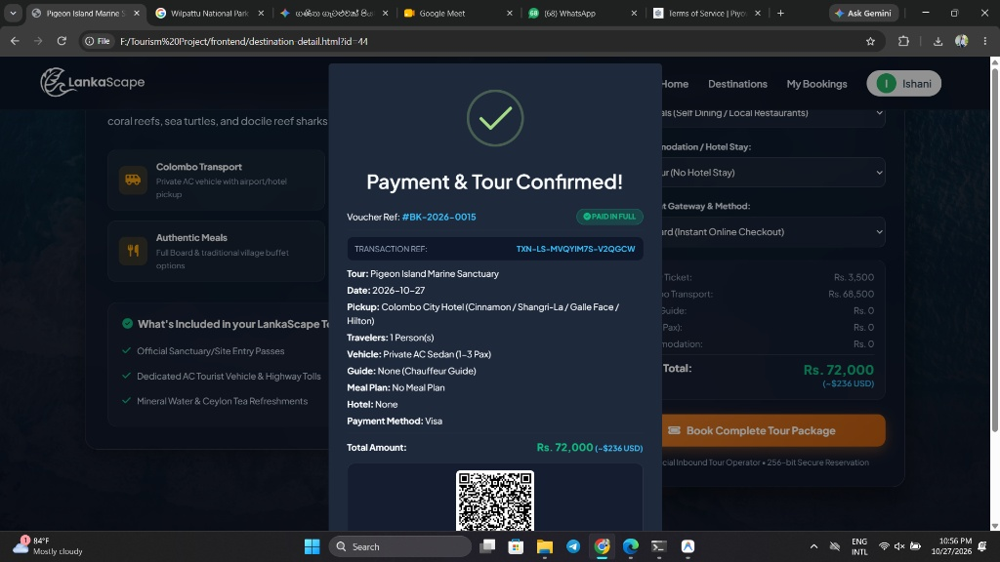
  <br>
  <em>Figure 3.2: Payment Gateway Checkout Interface with validation and LankaPay simulation</em>
</p>

### 3️⃣ READ Operations: Exploration Catalog & My Bookings Dashboard
* **Public Exploration (`index.html`):** Retrieves all 60 destinations via `GET /api/destinations`. Users can perform instant keyword searches, category pill filtering (*All, Beaches, Heritage, Hill Country, Wildlife, Nature*), and alphabetical A-to-Z sorting.
* **Personal Bookings (`my-bookings.html`):** Authenticated users view their active and past tour reservations retrieved via `GET /api/bookings/user/{userId}` with live dashboard summary statistics (*Total Trips, Total Spent*).

<p align="center">
  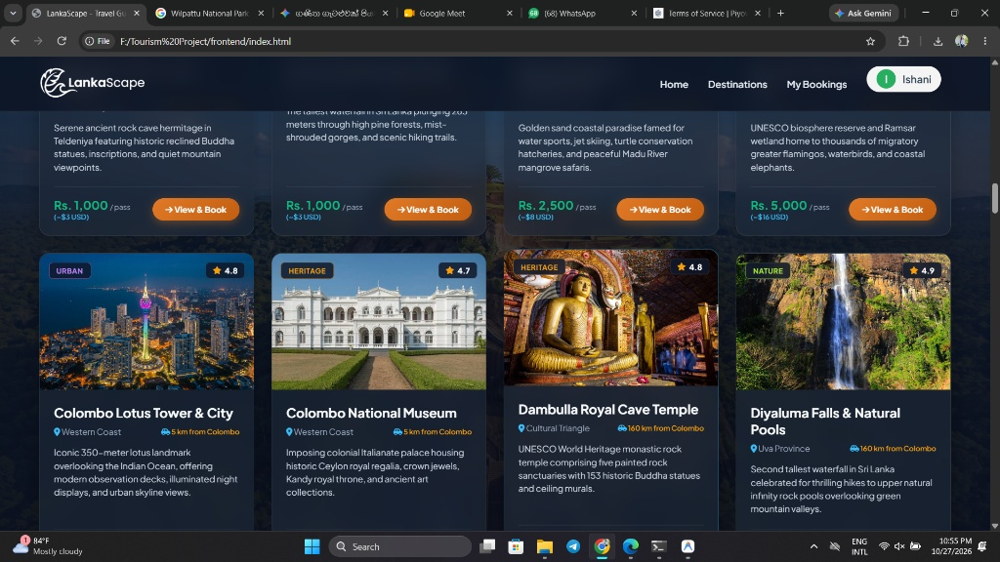
  <br>
  <em>Figure 2.1: READ Operations – 60 Curated Destinations with Live Search, Filter, and Sort Controls</em>
</p>

<p align="center">
  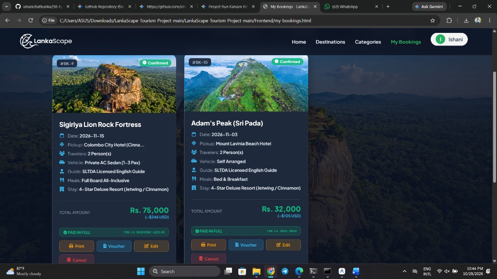
  <br>
  <em>Figure 3.3: READ Operations – User Dashboard displaying persistent booking records from MySQL</em>
</p>

### 4️⃣ E-Voucher Generation & Verification QR Pass
Each booking generates an official printable tour voucher with an itemized payment breakdown and a dynamic QR code (`https://api.qrserver.com/v1/create-qr-code/`) encoding the booking reference, lead traveler name, destination, date, and transaction hash.

<p align="center">
  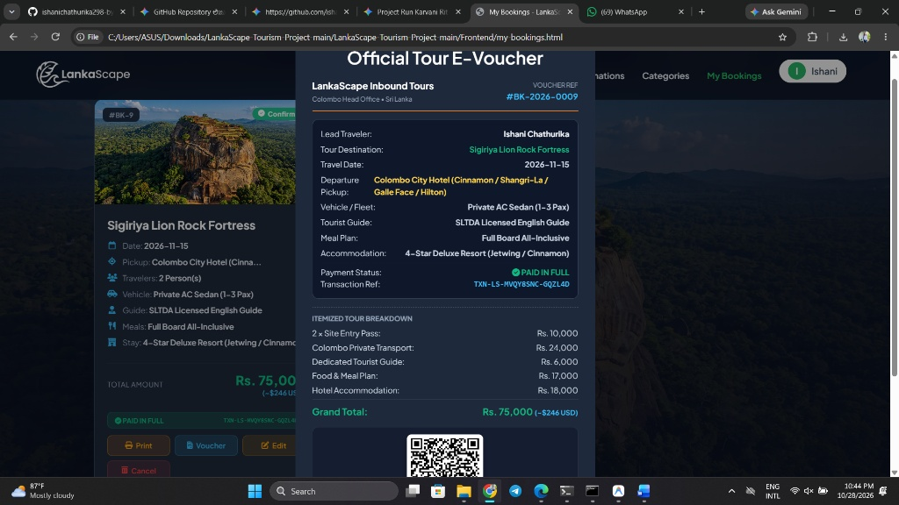
  <br>
  <em>Figure 3.4: Official Tour E-Voucher Modal with itemized breakdown and dynamic QR pass</em>
</p>

<p align="center">
  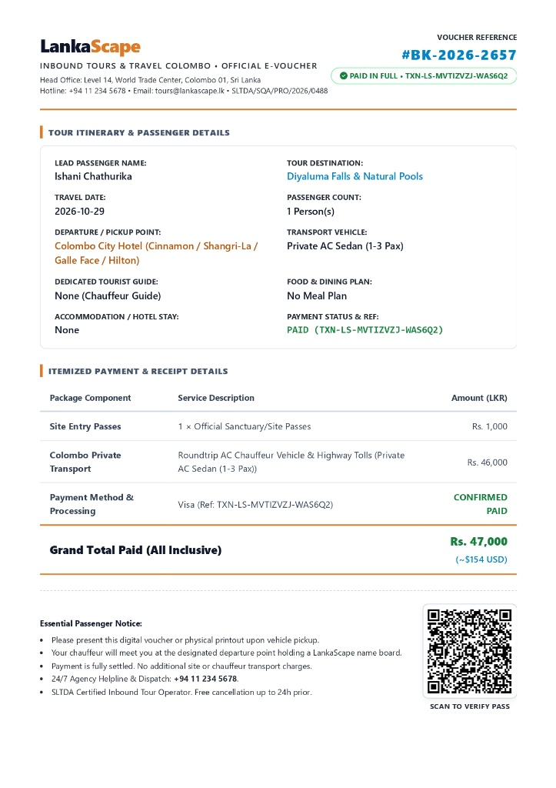
  <br>
  <em>Figure 3.5: Printable A4 Tour E-Voucher Pass with cryptographic verification hash</em>
</p>

### 5️⃣ UPDATE Operation: Modifying Existing Bookings
Travelers can reschedule dates, change passenger quantities, or upgrade their transport/hotel through an interactive modal on `my-bookings.html`. This dispatches a `PUT /api/bookings/{id}` request, updating the record in MySQL and recalculating totals in real-time.

<p align="center">
  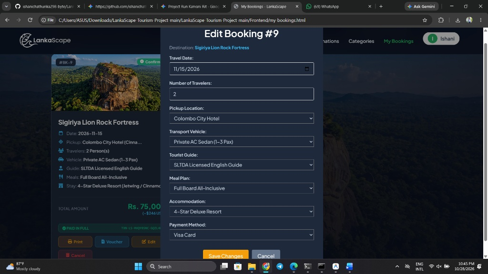
  <br>
  <em>Figure 3.6: UPDATE Operation – Interactive modal allowing users to safely edit and reschedule bookings</em>
</p>

### 6️⃣ DELETE Operation: Safe Reservation Cancellation
To prevent accidental data loss, clicking **Cancel** triggers a SweetAlert2 confirmation modal. When confirmed, a `DELETE /api/bookings/{id}` request executes, removing the record from the database and updating dashboard metrics dynamically.

<p align="center">
  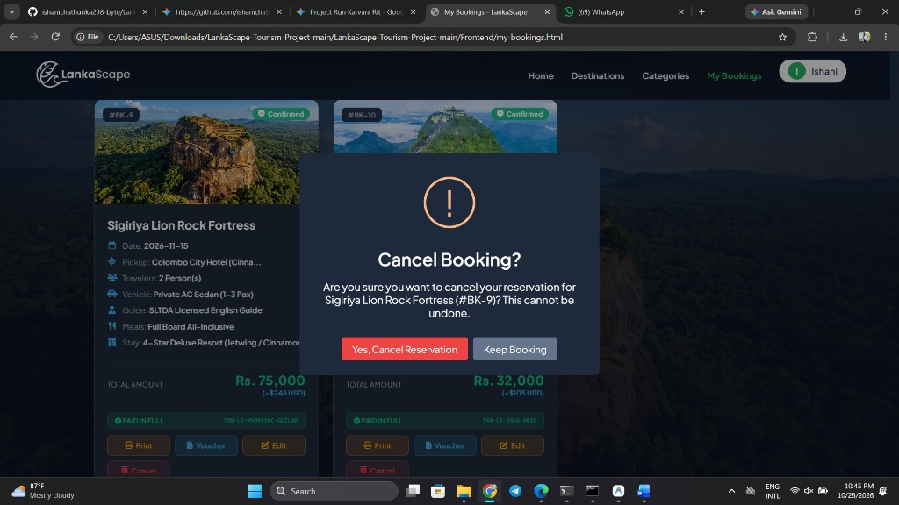
  <br>
  <em>Figure 3.7: DELETE Operation – Safe cancellation confirmation prompt with instant UI synchronization</em>
</p>

---

## 5. RESTful API Endpoints Specification

| HTTP Method | Endpoint URI | Access Role | Description & Data Handling |
| :---: | :--- | :---: | :--- |
| `GET` | `/api/destinations` | Public | Retrieves all 60 destinations sorted in A-to-Z alphabetical order. |
| `GET` | `/api/destinations/{id}` | Public | Fetches detailed information for a single destination by ID. |
| `POST` | `/api/users/register` | Public | Registers a new user account with duplicate email validation. |
| `POST` | `/api/users/login` | Public | Authenticates credentials and returns user profile session payload. |
| `POST` | `/api/bookings` | Authenticated | **CREATE:** Validates inputs, saves tour reservation in MySQL, and returns `201 Created`. |
| `GET` | `/api/bookings/user/{userId}` | Authenticated | **READ:** Retrieves all persistent reservations for the specified user. |
| `PUT` | `/api/bookings/{id}` | Authenticated | **UPDATE:** Modifies travel date, pax, vehicle, or hotel details and updates price. |
| `DELETE` | `/api/bookings/{id}` | Authenticated | **DELETE:** Safely removes a booking record from the MySQL database. |

---

## 6. Software Verification & Test Suite Matrix

| Test ID | Evaluation Criterion | Test Input / Action | Observed System Output | Status |
| :---: | :--- | :--- | :--- | :---: |
| **TC-01** | **CREATE Operation** | Submit booking for Sigiriya (2 Pax + Sedan + Guide + Full Board). | `201 Created`; record saved in MySQL; printable voucher & QR generated. | **PASSED** |
| **TC-02** | **READ: Search & Filter** | Search "Beach", filter by "Southern Coast", sort A-to-Z. | Real-time DOM filtering within <15ms; accurate destination matches shown. | **PASSED** |
| **TC-03** | **UPDATE Operation** | Edit Booking #9 travel date to `2026-11-20` and change to Mini Coach. | `200 OK`; updated in MySQL; total price recalculated and card refreshed. | **PASSED** |
| **TC-04** | **DELETE Operation** | Click Cancel on booking card and confirm SweetAlert2 prompt. | Record removed from MySQL; dashboard trip count and total spent updated. | **PASSED** |
| **TC-05** | **Input Validation** | Submit booking with empty date, 0 quantity, or invalid card number. | Client/server validation halts submission and displays clear error feedback. | **PASSED** |

---

## 7. Step-by-Step Project Setup & Execution Guide

### Prerequisites
* **Java Development Kit (JDK 17 or higher)**
* **MySQL Server 8.0** (running locally on port `3306`)
* **Modern Web Browser** (Google Chrome, Microsoft Edge, Mozilla Firefox)

---

### Option A: 1-Click Launch (Windows - Recommended)
1. Ensure your local MySQL service is running on port 3306.
2. In the project root directory, double-click **`RUN_PROJECT.bat`**.
3. The launcher will automatically:
   * Auto-detect your installed Java 17 runtime (`C:\Program Files\Java\jdk-17`).
   * Start the Spring Boot REST API backend on port 8080 in a dedicated console window.
   * Open `Frontend/index.html` in your default web browser.

---

### Option B: Step-by-Step Manual Setup

#### Step 1 — Clone the Repository
```bash
git clone https://github.com/ishanichathurika298-byte/LankaScape-Tourism-Project.git
cd LankaScape-Tourism-Project
```

#### Step 2 — Initialize the MySQL 8.0 Database
1. Open **MySQL Workbench** and connect to your local instance (`localhost:3306`).
2. Open and execute the script located at **`Backend/database.sql`** (or run via CLI):
   ```bash
   mysql -u root -p < Backend/database.sql
   ```
   *This automatically creates the `tourism_db` schema, generates `users`, `destinations`, and `bookings` tables, and pre-seeds all 60 destinations with distances and sample bookings.*

3. Verify your database credentials in `Backend/tourism-backend/src/main/resources/application.properties`:
   ```properties
   spring.datasource.url=jdbc:mysql://localhost:3306/tourism_db?useSSL=false&allowPublicKeyRetrieval=true&serverTimezone=UTC
   spring.datasource.username=root
   spring.datasource.password=Chathu#28
   ```
   *(If your local MySQL root password differs, update the `spring.datasource.password` line accordingly).*

#### Step 3 — Configure & Run the Spring Boot Backend
Open a terminal, navigate to the backend folder, and start the server:
```bash
cd Backend/tourism-backend

# Windows:
mvnw.cmd spring-boot:run

# Linux / macOS:
./mvnw spring-boot:run
```
The REST API server will initialize on **`http://localhost:8080`**.

#### Step 4 — Launch the Frontend Application
Simply open **`Frontend/index.html`** in any modern web browser, or launch it with the **VS Code Live Server** extension.

---
### Option C: Live Cloud Deployment (No Local Setup Required)

To ensure global accessibility without requiring any local database or server setup, the presentation layer (Frontend) of the LankaScape platform has been successfully deployed to the cloud via Netlify. You can access the live application directly using the link below:

* **Public Live URL:** [https://lankascape-tours.netlify.app](https://lankascape-tours.netlify.app)

### Demonstration Accounts

| Role | Email | Password | Access Details |
| :--- | :--- | :--- | :--- |
| **Primary User** | `ishanichathurika298@gmail.com` | `Chathu#28` | Pre-configured account with active persistent bookings. |
| **New Traveler** | *Any valid email* | *User choice* | Register instantly on `register.html` to create a new profile. |

---

## 8. Core Code Artifacts

### Spring Boot Controller (`BookingController.java`)
```java
@RestController
@RequestMapping("/api/bookings")
@CrossOrigin(origins = "*")
public class BookingController {

    @Autowired
    private BookingRepository bookingRepository;
    @Autowired
    private UserRepository userRepository;
    @Autowired
    private DestinationRepository destinationRepository;

    // CREATE: Persist new tour reservation with server-side validation
    @PostMapping
    public ResponseEntity<?> createBooking(@RequestBody BookingRequest request) {
        if (request.getQuantity() == null || request.getQuantity() <= 0) {
            return ResponseEntity.badRequest().body("Quantity must be at least 1!");
        }
        if (request.getTravelDate() == null || request.getTravelDate().trim().isEmpty()) {
            return ResponseEntity.badRequest().body("Travel date is required!");
        }
        return ResponseEntity.status(HttpStatus.CREATED).body(bookingService.saveBooking(request));
    }

    // READ: Retrieve bookings for authenticated user
    @GetMapping("/user/{userId}")
    public ResponseEntity<List<Booking>> getUserBookings(@PathVariable Long userId) {
        return ResponseEntity.ok(bookingRepository.findByUserIdOrderByIdDesc(userId));
    }

    // UPDATE: Modify reservation parameters and recalculate total
    @PutMapping("/{id}")
    public ResponseEntity<?> updateBooking(@PathVariable Long id, @RequestBody BookingRequest request) {
        return ResponseEntity.ok(bookingService.updateBooking(id, request));
    }

    // DELETE: Safely cancel and remove reservation
    @DeleteMapping("/{id}")
    public ResponseEntity<String> deleteBooking(@PathVariable Long id) {
        bookingRepository.deleteById(id);
        return ResponseEntity.ok("Booking deleted successfully!");
    }
}
```

---

## 9. Conclusion & References

The **LankaScape Tourism Project** demonstrates how modern web engineering principles can address key challenges in national tourism digitisation. By unifying comprehensive destination discovery, transparent multi-component pricing, and full persistent CRUD operations within a single decoupled platform, the system eliminates information asymmetry, middleman dependency, and operational overhead.

### References:
1. **Sri Lanka Tourism Development Authority (SLTDA):** *Annual Statistical Report of Sri Lanka Tourism*, Colombo, Sri Lanka.
2. **Spring Framework Documentation:** *Spring Boot 3.x Reference Guide & Spring Data JPA*, [https://spring.io/projects/spring-boot](https://spring.io/projects/spring-boot).
3. **Mozilla Developer Network (MDN):** *JavaScript ES6+, Fetch API, and Responsive CSS Grid/Flexbox Specifications*, [https://developer.mozilla.org](https://developer.mozilla.org).

---


